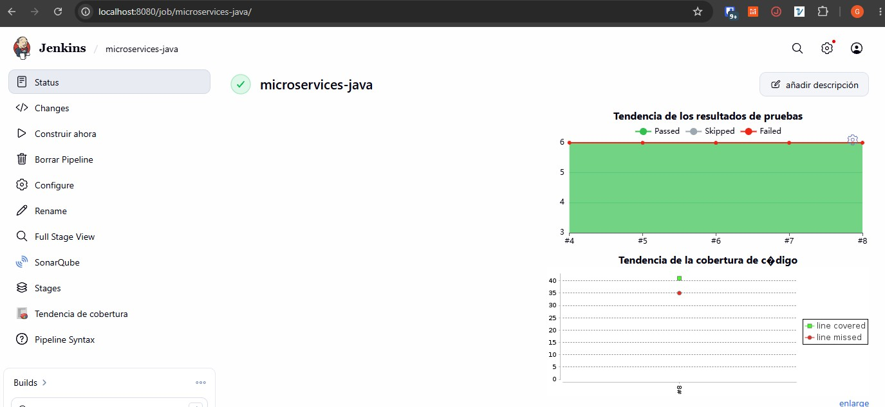
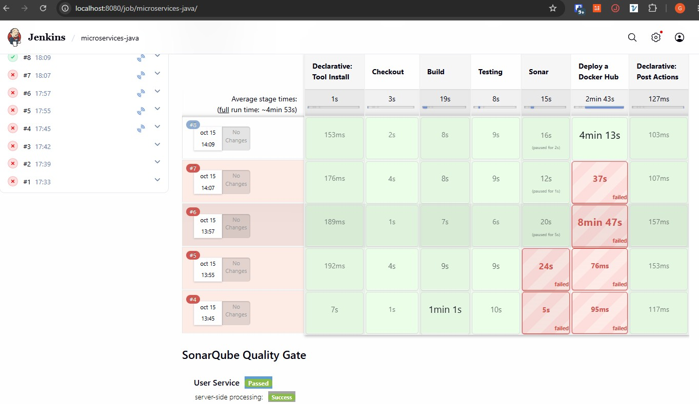
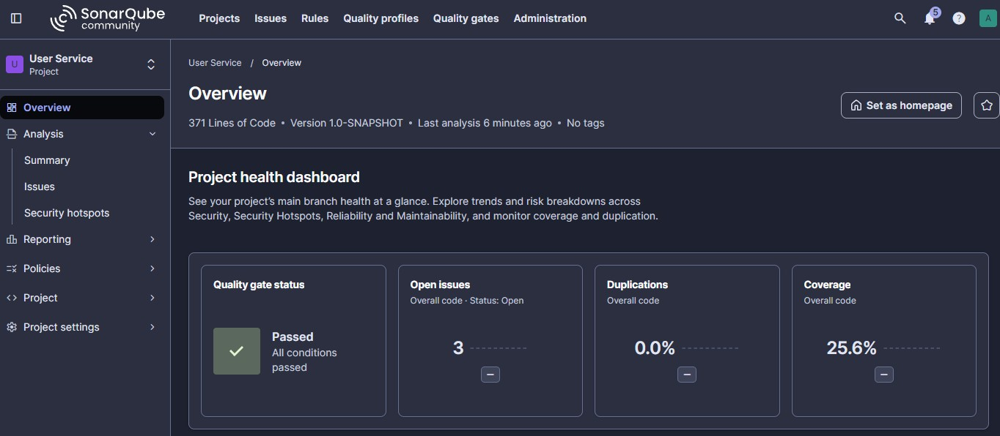
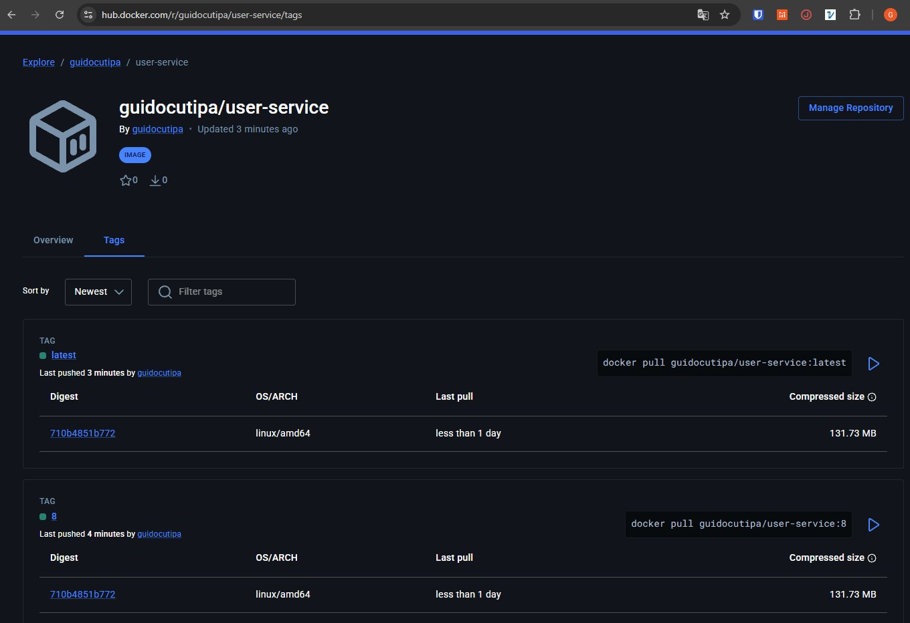

# Pipeline CI/CD — Tipo de Aplicación : Microservicios - Spring Boot

Pipeline de integración y entrega continua para una aplicación Spring Boot microservicios.

> 📖 Para la guía completa de configuración del entorno, ver [CONFIGURACION.md](CONFIGURACION.md)

---

## Herramientas configuradas en Jenkins

```groovy
 JDK: JDK-21
 maven 'Maven-3'
```

## Variables de entorno

Credenciales en Jenkins Credentials Store

```groovy
environment {
    SONAR_PROJECT_KEY  = 'user-service'
    SONAR_PROJECT_NAME = 'User Service'
    // Credencial tipo "Username with password" creada en Jenkins Credentials Store
    DOCKERHUB_CREDENTIALS = credentials('dockerhub-credentials')
    DOCKERHUB_REPO        = "${DOCKERHUB_CREDENTIALS_USR}/user-service"
}
```

## Flujo del pipeline

```
Checkout → Build → Testing → Sonar → Artifactory → Deploy
```






### Stage: Checkout
```groovy
stage('Checkout') {
    steps {
        deleteDir()
        sh 'git -c http.sslVerify=false clone https://github.com/dozmaz/devsecops-microservices-java.git .'
    }
}
```
* **`deleteDir()`**: Limpia completamente el espacio de trabajo antes de clonar.
* **`sh 'git ... .'`**: Clona el código fuente en la raíz del espacio de trabajo omitiendo validaciones SSL estrictas (`http.sslVerify=false`).

---

### Stage: Build (FAT JAR)

Generar el artefacto ejecutable tipo **FAT JAR** empaquetando todas las dependencias

```groovy
stage('Build') {
    steps {
        echo '=== STAGE: Build — FAT JAR ==='
        sh 'mvn -pl user-service -am clean package -DskipTests --no-transfer-progress'
    }
    post {
        failure { error 'Build fallido. Revisa los errores de compilacion.' }
    }
}
```

---

### Stage: Testing (JUnit + JaCoCo)

Ejecutar las pruebas unitarias y medir la cobertura de código.

```groovy
stage('Testing') {
    steps {
        echo '=== STAGE: Testing (JUnit + JaCoCo) ==='
        sh 'mvn -pl user-service -am test --no-transfer-progress'
    }
    post {
        always {
            junit 'user-service/target/surefire-reports/*.xml'
            jacoco(
                execPattern:         'user-service/target/jacoco.exec',
                classPattern:        'user-service/target/classes',
                sourcePattern:       'user-service/src/main/java',
                exclusionPattern:    '**/test/**',
                minimumLineCoverage: '50'
            )
        }
        failure { error 'Tests fallidos. Revisa los reportes JUnit/JaCoCo.' }
    }
}
```
* **`mvn test`**: Ejecuta los tests JUnit con el agente de JaCoCo activo.
* **Post-acciones (`always`)**:
  * **`junit`**: Publica el reporte de resultados de las pruebas unitarias procesando los XML de Surefire.
  * **`jacoco`**: Recolecta el archivo binario `jacoco.exec`, analiza las clases compiladas y valida una cobertura mínima de líneas del 50% (`minimumLineCoverage: '50'`).

---

### Stage: SonarQube
Análisis estático de código, seguridad y calidad.
El pipeline espera hasta **5 minutos** la evaluación del Quality Gate vía webhook.  
Si el Quality Gate falla el pipeline es abortado.

```groovy
stage('Sonar') {
    steps {
        echo '=== STAGE: SonarQube Analysis ==='
        withSonarQubeEnv('SonarQube') {
            sh """
                mvn -pl user-service -am org.sonarsource.scanner.maven:sonar-maven-plugin:sonar --no-transfer-progress \\
                  -Dsonar.projectKey=${SONAR_PROJECT_KEY} \\
                  -Dsonar.projectName='${SONAR_PROJECT_NAME}' \\
                  -Dsonar.java.source=17 \\
                  -Dsonar.coverage.jacoco.xmlReportPaths=user-service/target/site/jacoco/jacoco.xml
            """
        }
    }
    post {
        success {
            timeout(time: 5, unit: 'MINUTES') {
                waitForQualityGate abortPipeline: true
            }
        }
    }
}
```
* **`withSonarQubeEnv('SonarQube')`**: Inyecta la URL del servidor y el token de autenticación configurados en Jenkins.
* **`sonar-maven-plugin:sonar`**: Envía el análisis a SonarQube enlazando el reporte de cobertura generado por JaCoCo (`sonar.coverage.jacoco.xmlReportPaths`).
* **`waitForQualityGate abortPipeline: true`**: Pausa el pipeline hasta que SonarQube compute el análisis. Si el Quality Gate no cumple con los estándares de calidad definidos, el pipeline se aborta automáticamente.



---

### Stage: Deploy a Docker Hub
Empaquetar el FAT JAR en una imagen de contenedor y publicarla en el registro remoto Docker Hub.
```groovy
stage('Deploy a Docker Hub') {
    steps {
        echo '=== STAGE: Imagen Docker -> Docker Hub ==='
        sh '''
            docker build \
                -t ${DOCKERHUB_REPO}:${BUILD_NUMBER} \
                -t ${DOCKERHUB_REPO}:latest \
                user-service/

            echo ${DOCKERHUB_CREDENTIALS_PSW} | \
                docker login -u ${DOCKERHUB_CREDENTIALS_USR} --password-stdin

            docker push ${DOCKERHUB_REPO}:${BUILD_NUMBER}
            docker push ${DOCKERHUB_REPO}:latest

            docker logout
        '''
    }
    post {
        failure { error 'Push a Docker Hub fallido. Revisa las credenciales.' }
    }
}
```
* **Acciones ejecutadas**:
  1. `docker build`: Construye la imagen usando el [`user-service/Dockerfile`](./user-service/Dockerfile), asignando dos etiquetas: el número de compilación `${BUILD_NUMBER}` y `latest`.
  2. `docker login`: Autentica en Docker Hub de forma segura mediante `stdin` con las credenciales inyectadas.
  3. `docker push`: Publica ambas etiquetas en el repositorio remoto.
  4. `docker logout`: Cierra la sesión en el host ejecutor.



---

## Post-Ejecución Global

```groovy
    post {
        success { echo "Pipeline OK. Imagen: ${DOCKERHUB_REPO}:${BUILD_NUMBER}" }
        failure { echo "Pipeline FALLIDO en build #${BUILD_NUMBER}" }
        always  { cleanWs() }
    }
```

* **`success`**: Imprime mensaje de confirmación con el nombre y tag de la imagen generada.
* **`failure`**: Notifica el fallo del build identificando el número de ejecución.
* **`always`**: Ejecuta `cleanWs()` para garantizar la eliminación de residuos del espacio de trabajo al finalizar la ejecución.

---
